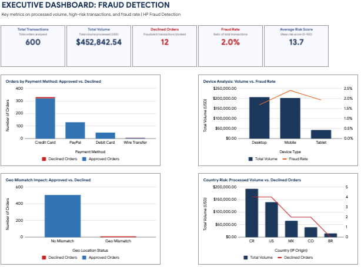
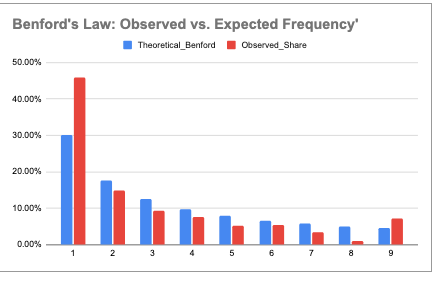

# Fraud-decision-Engine
Production-grade Excel Fraud Decision Engine featuring automated risk scoring, heuristic classification, and Benford's Law forensic anomaly detection.
A production-grade, rule-based Fraud Decision Engine and analytical dashboard built in Microsoft Excel. This project models end-to-end e-commerce risk mitigation, automated order classification, and statistical audit procedures using Benford's Law.


##  Visual Overview & Executive Dashboard



---

##  Problem Statement & Analytical Approach

### The Business Challenge
In high-volume e-commerce environments, risk operations face a dual challenge:
1. **Preventing Fraud Losses:** Blocking stolen credit cards, fake accounts, and unauthorized transactions.
2. **Minimizing Friction & False Positives:** Ensuring legitimate buyers are not delayed by unnecessary manual reviews or incorrect declines.

###  Methodological Solution
The engine implements a two-tier evaluation framework:
1. **Transaction-Level Heuristic Engine:** Evaluates each incoming order upon arrival against multi-variable risk vectors—including geographic location mismatches, transaction value thresholds, and device type profiling—to assign automated operational outcomes (`Approve`, `Manual Review`, or `Decline`).
2. **Post-Processing Forensic Audit:** Applies logarithmic probability analysis (**Benford's Law**) across the aggregate dataset to evaluate structural integrity and detect systematic anomaly patterns or order structuring (smurfing).

---

## Rule Architecture & Decision Logic

<details>
<summary><b>🔍 Click to expand: Detailed Risk Scoring & Rule Building in Excel</b></summary>

<br>

### 1. Multi-Vector Condition Evaluation
The engine evaluates three core operational dimensions per order using structured logical formulas:
* **Geographic Alignment (`Geo Status`):** Cross-references IP geolocation against billing/shipping country data. Discrepancies add a heavy risk weight due to high correlation with proxy/VPN spoofing.
* **Transaction Size Thresholds (`Amount`):** High-ticket values (e.g., transactions exceeding $1,500) trigger heightened scrutiny to protect operational margins on high-end devices.
* **Device Profiling (`Device Type`):** Tracks historical risk profiles across Desktop, Mobile, and Tablet to apply channel-specific risk weightings.

### 2. Tiered Operational Routing
Nested logical functions (`IF`, `AND`, `OR`) convert cumulative risk parameters into three clear operational outcomes:
* **`Approve` (Low Risk):** Transactions with minimal risk pass straight to fulfillment, ensuring zero conversion friction.
* **`Manual Review` (Medium Risk):** Borderline risk patterns are routed to an analyst queue, containing exposure without immediate rejection.
* **`Decline` (High Risk):** Multi-flag orders (e.g., Geo Mismatch + High Amount) are automatically blocked to insulate revenue.

### 3. Dynamic Aggregations & Dashboard Integration
* Utilizes conditional summary functions (`SUMIFS`, `COUNTIFS`, `COUNTIF`) and lookup matrices (`XLOOKUP`) to feed metric cards and charts dynamically directly from the underlying data tables without hardcoding.

</details>

---

## Forensic Audit Module: Benford's Law Analysis



<details>
<summary><b>📖 Click to expand: Methodology & Anomaly Detection Findings</b></summary>

<br>

### Theoretical Framework
Benford’s Law states that in naturally occurring numerical datasets, the number `1` will be the leading first digit approximately **30.1%** of the time, while the number `9` will appear as the leading digit only **4.6%** of the time, adhering to the logarithmic formula:

$$P(d) = \log_{10}\left(1 + \frac{1}{d}\right)$$

### Forensic Value in Fraud Analytics
* **Organic Behavior Verification:** Legitimate spending across hardware lines produces a first-digit frequency that mirrors the logarithmic Benford curve.
* **Smurfing / Structuring Detection:** Fraudsters attempting to bypass manual review thresholds (e.g., splitting a $5,000 fraud ring into multiple $900–$999 orders) artificially distort the natural digit distribution.
* **Audit Finding:** Comparing `Observed_Share` against `Theoretical_Benford` confirms that transaction volume follows expected statistical curves without systemic artificial manipulation.

</details>

---

## 🛠️ Excel Technical Implementation

```text
├── Advanced Formulas:   XLOOKUP, VLOOKUP, Nested IFs, SUMIFS, COUNTIFS, COUNTIF
├── Statistical Logic:   LOG10 for dynamic logarithmic Benford curve generation
├── Data Visualization:  Pivot Tables, Dynamic Metric Cards, Clustered Column + Line Combo Charts
└── Architecture:        Modular tab separation (Data, Decision Logic, Dashboard, Audit Engine)
